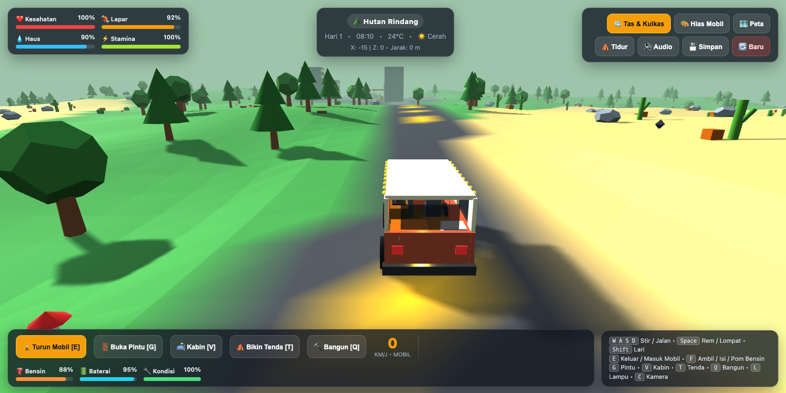

# Nomad Vanlife Survival

Game survival dunia terbuka berbasis browser. Jelajahi dunia prosedural tanpa batas dengan camper van, kelola kebutuhan bertahan hidup, masak di dalam kabin, dan bangun perkemahan di alam liar.

Dibangun dengan JavaScript murni dan Three.js, tanpa framework, tanpa proses build, dan dapat dijalankan langsung dari browser.



## Fitur

- Dunia prosedural tanpa batas dengan sistem chunk dan jalan raya yang menghubungkan antar wilayah.
- Enam bioma: hutan, gurun, pantai, pegunungan, desa, dan kota, masing-masing dengan sumber daya dan karakteristik cuaca sendiri.
- Kendaraan camper van yang dapat dikendarai, ditinggalkan, dan dihias.
- Mode berjalan kaki dengan animasi, sprint, lompat, serta interaksi dengan objek di dunia.
- Sistem survival: kesehatan, rasa lapar, rasa haus, stamina, dan pengaruh suhu lingkungan.
- Kulkas mobil dengan tingkat kesegaran makanan dan konsumsi daya baterai.
- Kompor kabin untuk memasak bahan mentah dan meracik perlengkapan.
- Mode membangun untuk memasang pagar kayu dan api unggun.
- Kustomisasi van: warna bodi, warna aksen, corak, aksesori, dan peningkatan kapasitas.
- Siklus siang dan malam serta cuaca dinamis: cerah, kabut, hujan, badai, badai pasir, dan salju.
- Pintu van, tampilan kabin, dan tenda samping yang dapat dibuka.
- Simpan otomatis ke `localStorage` setiap 15 detik.
- Kontrol sentuh untuk perangkat mobile.

## Teknologi

| Komponen | Keterangan |
| --- | --- |
| Three.js r128 | Rendering 3D melalui WebGL, dimuat dari CDN |
| JavaScript ES6 | Logika game, tanpa framework dan tanpa build step |
| CSS3 | Antarmuka HUD dan modal |
| Web Audio API | Efek suara dan audio kendaraan |
| LocalStorage | Penyimpanan progres permainan |

## Menjalankan

Prasyarat: browser modern (Chrome, Edge, atau Firefox) dan koneksi internet untuk memuat Three.js dari CDN.

```bash
git clone https://github.com/ridzidev/Nomad-Vanlife-Survival-Gsame.git
cd Nomad-Vanlife-Survival-Gsame
python3 -m http.server 8000
```

Buka `http://localhost:8000` di browser.

Alternatif lain:

```bash
npx serve .
```

`index.html` juga dapat dibuka langsung, tetapi menjalankannya melalui local server lebih disarankan agar perilaku browser konsisten.

## Kontrol

### Mengemudi dan berjalan

| Aksi | Tombol |
| --- | --- |
| Gas, mundur, belok, berjalan | `W` `A` `S` `D` atau tombol panah |
| Sprint | `Shift` |
| Rem tangan saat mengemudi, lompat saat berjalan | `Space` |
| Keluar atau masuk camper van | `E` |
| Ambil barang, isi bahan bakar, interaksi | `F` |
| Lampu utama | `L` |
| Klakson | `H` |
| Ubah jarak kamera | `C` |
| Putar kamera | Drag mouse |

### Menu dan kendaraan

| Aksi | Tombol |
| --- | --- |
| Buka tas, kulkas, dan kompor | `Tab` atau `I` |
| Buka bengkel dan kustomisasi van | `B` |
| Buka peta bioma | `M` |
| Tutup menu | `Esc` |
| Buka atau tutup pintu van | `G` |
| Tampilan kabin | `V` |
| Pasang atau lipat tenda samping | `T` |
| Mode membangun | `Q` |
| Putar objek yang akan dibangun | `R` |
| Bongkar bangunan terdekat | `X` |

Tombol HUD menyediakan akses cepat untuk tidur, audio, simpan manual, dan memulai dunia baru.

## Mekanik Utama

### Bertahan hidup

Kesehatan, rasa lapar, rasa haus, dan stamina menurun seiring waktu. Suhu bioma memengaruhi kecepatan penurunan kondisi. Tidur di camper van memulihkan stamina dan memajukan waktu.

### Makanan dan kulkas

Bahan segar memiliki indikator kesegaran. Jika dibiarkan di tas terlalu lama, makanan akan basi. Simpan makanan di kulkas mobil untuk memperlambat pembusukan, dengan konsekuensi konsumsi daya baterai.

### Memasak dan merakit

Kompor kabin dapat mengolah bahan mentah menjadi makanan yang lebih bergizi, seperti steak, ikan bakar, sup jamur, dan kopi. Scrap dan kayu dapat dirakit menjadi kit perbaikan atau bahan bakar darurat.

### Membangun dan berkemah

Mode membangun memungkinkan pemasangan pagar kayu dan api unggun di sekitar lokasi perkemahan. Api unggun dan tenda samping mendukung suasana berkemah, terutama pada malam hari.

### Kustomisasi van

Van dapat diubah warna dan coraknya, serta dilengkapi aksesori seperti panel surya, rak atap, bumper off-road, awning, dan tenda extension. Kapasitas kulkas, tangki bahan bakar, dan baterai juga dapat ditingkatkan.

## Struktur Proyek

```text
.
├── index.html          # Markup HUD dan modal
├── css/
│   └── style.css       # Gaya antarmuka
├── js/
│   ├── data.js         # Item, resep, dekorasi, upgrade, dan data bioma
│   ├── audio.js        # Sintesis audio Web Audio API
│   ├── state.js        # State permainan dan penyimpanan localStorage
│   ├── scene.js        # Scene, kamera, cahaya, dan input global
│   ├── world.js        # Generator terrain dan chunk streaming
│   ├── van.js          # Model, dekorasi, dan fisika camper van
│   ├── build.js        # Sistem membangun pagar dan api unggun
│   ├── player.js       # Karakter, animasi, dan interaksi
│   ├── weather.js      # Cuaca dinamis dan partikel
│   ├── ui.js           # HUD, inventori, kulkas, kompor, dan peta
│   └── main.js         # Input, transisi kamera, dan game loop
├── docs/
│   └── preview.png     # Tangkapan layar
├── LICENSE
└── README.md
```

## Penyimpanan

Progres disimpan otomatis setiap 15 detik pada `localStorage` dengan kunci `nomad_vanlife_survival_v1`. Data yang disimpan mencakup posisi van, isi tas dan kulkas, tingkat kesegaran, dekorasi, serta objek dunia yang sudah diambil.

Gunakan tombol Simpan pada HUD untuk menyimpan secara manual, atau tombol Baru untuk memulai dunia dengan seed acak baru.

## Roadmap

Proyek ini merupakan prototipe yang dapat dimainkan secara penuh. Pengembangan selanjutnya diarahkan pada:

- Migrasi ke Vite dan TypeScript dengan struktur modul yang lebih terpisah.
- Pemindahan generasi chunk ke Web Worker serta penggunaan `InstancedMesh` dan LOD.
- Fisika kendaraan yang lebih realistis dengan raycast suspension.
- Interior camper van yang dapat dimasuki dan diinteraksikan secara langsung.
- Perawatan komponen kendaraan: ban, oli, aki, dan radiator.
- Cuaca yang memengaruhi permainan, misalnya jalan licin saat hujan dan hipotermia di pegunungan.
- Landmark, satwa liar, sistem memancing, dan NPC pengembara.
- Radio mobil, musik dinamis, dan penyimpanan cloud multi-slot.
- Paket desktop atau mobile melalui Tauri, Electron, atau Capacitor.

## Kontribusi

Kontribusi terbuka untuk perbaikan bug, penambahan fitur, atau penyempurnaan dokumentasi. Buat branch baru, lakukan perubahan, lalu ajukan pull request dengan deskripsi yang jelas.

## Lisensi

Dirilis di bawah lisensi MIT. Lihat [LICENSE](LICENSE) untuk detail.
